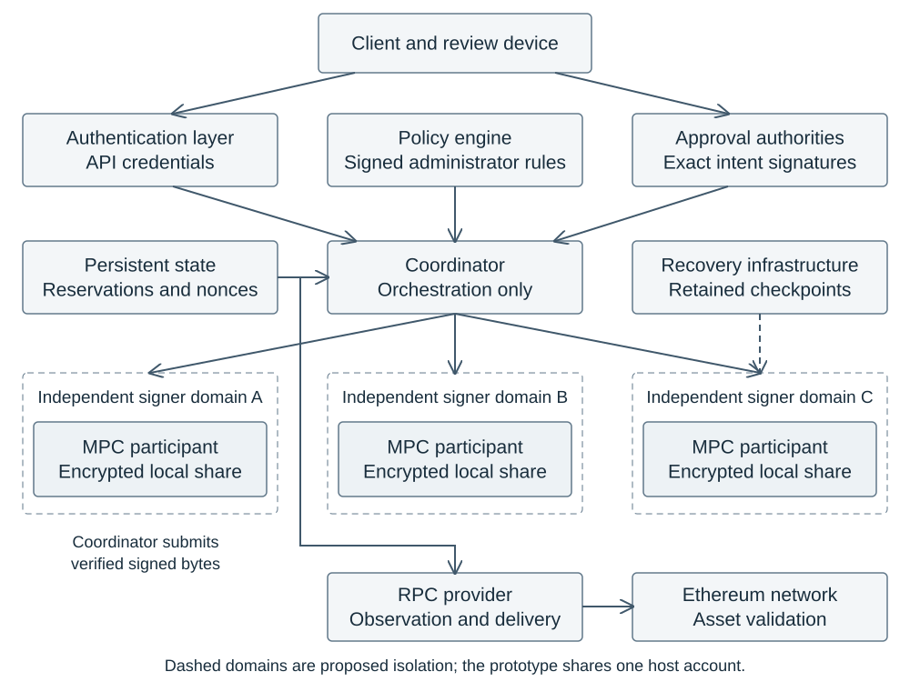
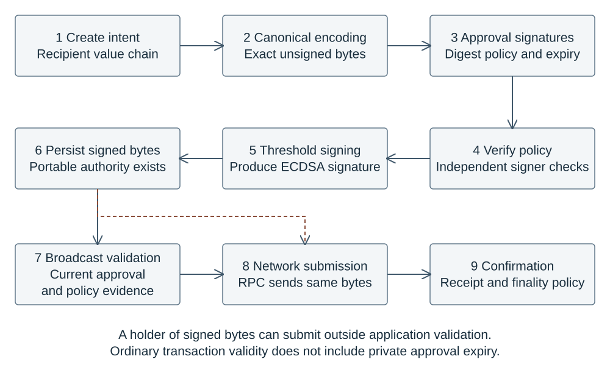
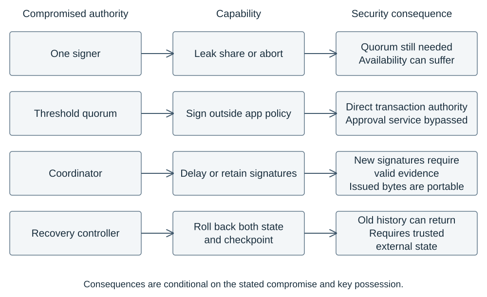
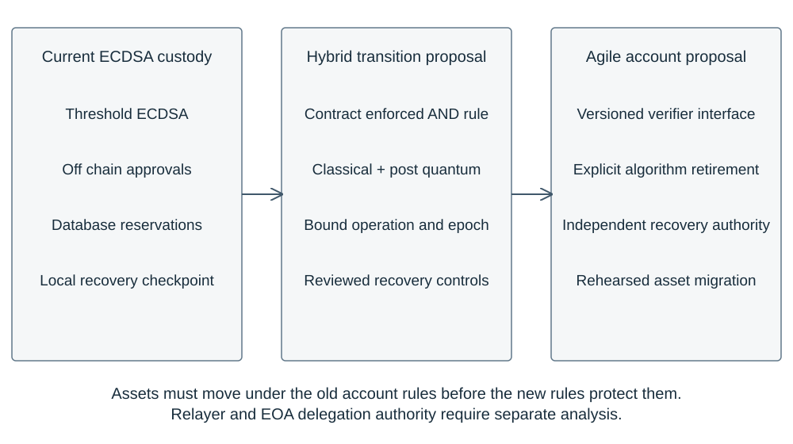

# Securing Institutional Digital Asset Custody

### Private Keys, Distributed Trust, and the Uncomfortable Arrival of Quantum Computing

**Dimitris Konstantinou · Independent research · 21 October 2026**

A mathematically valid signature does not necessarily represent an authorized transaction. Institutional custody depends on who can sign, who can approve, which history participants trust, and what recovery can silently restore. This research examines those boundaries in a concrete Ethereum custody implementation, then asks what must change when elliptic curve signatures face quantum attacks.

**[Read the Full Research Paper (PDF)](paper/custody-security-research.pdf)**

[Editable Word document](paper/custody-security-research.docx) · [Reproduce the experiments](experiments/README.md) · [Recorded results](results/EXPERIMENT_RESULTS.md) · [Research limitations](docs/RESEARCH_LIMITATIONS.md)

**[Security Research Index](RESEARCH_INDEX.md)** · [Active AWS custody security lab](https://github.com/demis1997/aws-custody-security-lab)

## Findings and their evidence

1. **Threshold signing does not establish a shared spending history.** A declared ledger model plus the implementation's real authorization function admits two individually approved reservations totaling **1.200084 ETH against a 1 ETH budget** under divergent partial histories. A central serial model rejects the second request. This is a counterexample under an explicit attacker model, not an executed exploit against PostgreSQL or native MPC.
2. **Application approval expiry does not revoke an ordinary Ethereum signature.** The actual broadcast validator rejected expired evidence, while unchanged transaction bytes signed with a synthetic complete test key were accepted by local Anvil. Receipt status was **1**; duplicate submission was rejected. Full MPC signature generation and the custody worker were not executed in this experiment.
3. **Recovery depends on the checkpoint's independence.** Real recovery functions rejected stale, missing, or altered retained checkpoints. Restoring a matching old backup and old checkpoint together succeeded under declared privileged access. The test used one administrator and synthetic state; it does not demonstrate independently administered recovery or live replay.
4. **Threshold ECDSA inherits the quantum exposure of elliptic curve cryptography.** Distributing a secret constrains its use under classical assumptions; it does not change the public key's underlying discrete logarithm problem. This conclusion follows from cryptographic analysis, not a quantum attack experiment.

These results examine documented trust boundaries in [Quorum Custody](https://github.com/demis1997/quorum-custody), at [commit `691e253`](https://github.com/demis1997/quorum-custody/tree/691e253ccdc2756afe215a23384eb72e2d4fde3c). They do not claim a newly discovered exploitable vulnerability in Coinbase MPC or a production custodian.

## Experiments

| Experiment | Research question | Observed result | Verification scope | Reproduction |
| --- | --- | --- | --- | --- |
| A · Spending history | Can valid individual approvals establish a global budget? | Divergent views admit 1.200084 ETH; central serial model rejects the second reservation. | Real `authorize` calls plus declared ledger model; no PostgreSQL or MPC execution. | [Run harness, record A](experiments/README.md#run-and-inspect) |
| B · Approval expiry | Can retained signed bytes outlive application approval? | Validator rejects expiry; direct local-chain submission succeeds; duplicate nonce is rejected. | Real validator, ordinary complete test key, real Anvil; no full worker or threshold signing. | [Run harness, record B](experiments/README.md#run-and-inspect) |
| C · Recovery rollback | What happens when state and checkpoint roll back together? | Individual stale/missing/altered checkpoints rejected; joint rollback accepted. | Unmodified recovery functions and synthetic state under one administrator. | [Run harness, record C](experiments/README.md#run-and-inspect) |
| D · Failure transitions | Which retry and terminal transitions are permitted? | Selected retries accepted; confirmed-to-signing rejected; B's duplicate nonce rejected. | Pure transition functions plus local-chain duplicate; native outage scenarios not executed. | [Run harness, record D](experiments/README.md#run-and-inspect) |
| Verification benchmark | What are local verification costs and object sizes? | Six scheme/composition rows with sizes and seven batch means each. | JavaScript CPU measurements; no EVM, gas, HSM, or threshold PQ benchmark. | [Run benchmark](experiments/README.md#verification-microbenchmark) |

The repository unit suite was repeated with **26 passed, zero failed, zero skipped**. [Raw evidence](results/) preserves the paper's run. Fresh runs write to ignored `results/local/`, so reproduction cannot replace published observations. Timing and transaction identifiers naturally vary between runs.

## Architecture and authorization



*Representative trust boundaries. Dashed signer domains describe proposed institutional isolation; the inspected prototype runs under one host account. The coordinator submits verified signed bytes to RPC. Every signer also needs independently governed recovery.*



*Authorization and network validity have different lifetimes. Once ordinary signed bytes exist, another holder can submit them outside application validation.*



*Consequences depend on which authority is compromised. A single compromised share, a threshold quorum, a coordinator, and a recovery controller have different capabilities.*

## Post quantum custody

The paper compares **ML-DSA** and **SLH-DSA**, measures local verification, and proposes hybrid authorization that requires both classical and post quantum evidence over the same operation. A contract account must enforce that rule at the asset boundary, including upgrades and recovery. Off-chain PQ approvals do not protect an ordinary account whose ECDSA key still suffices to move its assets.



*Proposed migration, not an implemented deployment. Assets must move under the old account rules before the new rules protect them. ERC-4337 and EIP-7702 require separate analysis of surviving owner, delegation, relayer, and upgrade authority.*

See **Sections 11–12, pages 17–21**, of the [full migration proposal](paper/custody-security-research.pdf#page=17). [The AWS lab roadmap](docs/AWS_CUSTODY_SECURITY_LAB_ROADMAP.md) develops the next infrastructure questions without assuming hardware compatibility or deploying cloud resources.

## Reproduce

Use **Node 22.20.0**, **npm 10.9.3**, Git, and Anvil on `PATH`. The publication run used Apple M3 Max, macOS ARM64 / Darwin 25.5.0, and Anvil 1.3.5 nightly (`9cd8a9511bc7206cb251721fa42420a76c668ae3c`). CI uses the available Anvil **v1.3.5** release and records its exact runtime; these environments are distinct.

```sh
git clone https://github.com/demis1997/institutional-custody-security-research.git
cd institutional-custody-security-research
nvm install
nvm use
bash experiments/setup.sh
bash experiments/run.sh
```

Setup fetches the exact application commit into ignored `source/quorum-custody/`, verifies all 82 source hashes, and installs lockfile dependencies with lifecycle scripts disabled. The harness starts one loopback Anvil process on port 18545 and stops only that process. Set `RESEARCH_PORT` to a different unused port if needed. No cloud account, wallet credentials, real assets, Docker, or native MPC build is needed for this scoped runner.

Full native MPC/PostgreSQL integration, independently administered recovery, and native outage campaigns remain **Not Executed**. Follow [the detailed instructions and limitations](experiments/README.md) before interpreting the output.

## Repository guide

- [Paper and editable document](paper/) · [Authoring source](paper/source/README.md)
- [Experiment scripts](experiments/) · [Published evidence](results/)
- [Research changelog](docs/RESEARCH_CHANGELOG.md) · [Limitations](docs/RESEARCH_LIMITATIONS.md)
- [Pinned source manifest](docs/SOURCE_MANIFEST.json) · [Redistribution and attribution review](docs/REDISTRIBUTION.md)
- [AWS Institutional Custody Security Lab roadmap](docs/AWS_CUSTODY_SECURITY_LAB_ROADMAP.md)

## Citation

Use [CITATION.cff](CITATION.cff), or cite:

> Dimitris Konstantinou. *Securing Institutional Digital Asset Custody: Private Keys, Distributed Trust, and the Uncomfortable Arrival of Quantum Computing*. Independent research artifact, version 1.0.0, 21 October 2026. https://github.com/demis1997/institutional-custody-security-research

No DOI, institutional affiliation, or peer reviewed publication status is claimed.

## Related implementation and license

[Quorum Custody](https://github.com/demis1997/quorum-custody) is the separately maintained implementation examined by this research. This repository does not modify it or vendor its full source tree; setup fetches the pinned revision. The research paper, original diagrams, authoring source, and harness are released under the [MIT license](LICENSE). Third-party rights and retained notices are documented in [Redistribution and attribution](docs/REDISTRIBUTION.md).
